# ChargeGrid Intelligence

**EV Challenge GoodWe + FIAP 2026 · Sprint 4 · Solução final integrada · Ecovolts**

> O ChargeGrid transforma o carregador residencial **GoodWe HCA G2** em um eletroposto
> compartilhado para galerias e mini-shoppings. Um aplicativo, dois papéis: o **motorista**
> encontra a vaga, pluga e paga só pelos kWh entregues; o **gestor da galeria** controla
> a demanda contratada, a tarifa e o repasse, com uma IA que prevê a demanda, modula o
> preço pelo sol e recomenda quando deslocar carga.

| | |
|---|---|
| 🎥 **Vídeo técnico (até 5 min)** | `<link do YouTube não listado>` |
| 📱 **App (abre sem instalar nada)** | [`app/dist/ChargeGrid-app.html`](app/dist/ChargeGrid-app.html) |
| 🧠 **Notebook de machine learning** | [`inteligencia/ChargeGrid_ML.ipynb`](inteligencia/ChargeGrid_ML.ipynb) |
| 🤖 **Síndico Virtual (LLM + RAG)** | [`supabase/functions/assistente/`](supabase/functions/assistente/) |
| 💳 **Pagamento integrado (Pix e cartão)** | [`supabase/functions/pagamentos/`](supabase/functions/pagamentos/) |
| 📄 **Documento de requisitos (Nano Engenharia de Software)** | [`docs/requisitos/Mapeamento-de-Requisitos-Nano-Engenharia-de-Software.docx`](docs/requisitos/Mapeamento-de-Requisitos-Nano-Engenharia-de-Software.docx) |
| 📋 **Rastreabilidade dos requisitos** | [`docs/rastreabilidade-requisitos.md`](docs/rastreabilidade-requisitos.md) |
| 🎬 **Roteiro do vídeo** | [`docs/roteiro-video.md`](docs/roteiro-video.md) |
| 🖥️ **Apresentação da Sprint 4 (16:9)** | [`docs/ChargeGrid-Sprint4.pptx`](docs/ChargeGrid-Sprint4.pptx) |

---

## Sumário

1. [Equipe](#1-equipe)
2. [O desafio e a nossa resposta](#2-o-desafio-e-a-nossa-resposta)
3. [Arquitetura final e integração dos sistemas](#3-arquitetura-final-e-integração-dos-sistemas)
4. [Como cada parte resolve o desafio](#4-como-cada-parte-resolve-o-desafio)
5. [Tecnologias GoodWe e por que cada uma](#5-tecnologias-goodwe-e-por-que-cada-uma)
6. [Alinhamento ao desafio GoodWe e à disciplina](#6-alinhamento-ao-desafio-goodwe-e-à-disciplina)
7. [Resultados quantitativos e qualitativos](#7-resultados-quantitativos-e-qualitativos)
8. [Avaliação crítica: sustentabilidade e inovação](#8-avaliação-crítica-sustentabilidade-e-inovação)
9. [Referências: frameworks, ferramentas, linguagens e sensores](#9-referências-frameworks-ferramentas-linguagens-e-sensores)
10. [Estrutura do repositório e como rodar](#10-estrutura-do-repositório-e-como-rodar)

---

## 1. Equipe

**Ecovolts** — Turma CCPW · Equipe 4 · FIAP · EV Challenge GoodWe 2026

| RM | Nome | Papel |
|---|---|---|
| 572899 | Patrick Fernandes Martins Pais | Scrum Master |
| 571836 | Bruna Yukimy Hada | Desenvolvedora |
| 571562 | Denize Ferrante | Desenvolvedora e Product Owner |
| 570436 | Gabriel Del Pizzo Pintor | Desenvolvedor |
| 572395 | Gabriel Dias Menezes | Desenvolvedor |
| 570540 | Ian Rodrigues Martins | Desenvolvedor |


---

## 2. O desafio e a nossa resposta

A GoodWe pediu uma solução que leve a linha residencial HCA G2 para o setor comercial
com **otimização em tempo real, controle de demanda e tarifação dinâmica**, apoiada em
dados estruturados e com a **IA como motor lógico** — não como enfeite de interface.
No [mapeamento de requisitos (Nano Engenharia de Software)](docs/requisitos/Mapeamento-de-Requisitos-Nano-Engenharia-de-Software.docx) isso virou quatro pilares:

| Pilar do desafio | O problema real | Resposta do ChargeGrid |
|---|---|---|
| **I. Controle de demanda (DLM)** | Ligar 4 carregadores de 7 kW numa galeria com 55 kW contratados arrisca multa por ultrapassagem | Teto dinâmico = contratada − pico previsto da edificação − 12% de margem, repartido entre as vagas em carga |
| **II. Protocolos abertos** | O HCA G2 fala Modbus; operadores de recarga (CPOs) falam OCPP 1.6 | Todo o modelo de eventos (início, medição, falha) usa o vocabulário OCPP 1.6; o gateway Modbus→OCPP é o próximo passo de hardware |
| **III. Tarifação e pagamento** | Preço precisa ser transparente (ANEEL 1.000/2021) e o RFID limita usuários | Tarifa **travada no plug-in**, pagamento por app/QR Code (sem cartão RFID), **pré-autorização e captura parcial** via API do Mercado Pago |
| **IV. IA como motor lógico** | Sem previsão, a galeria compra energia cara na ponta e deixa sol sobrando | **Random Forest** prevê consumo da galeria e do eletroposto hora a hora, **K-Means** classifica o dia, o **fator α** modula o preço e o **Síndico Virtual** (LLM + RAG) explica tudo em linguagem natural |

---

## 3. Arquitetura final e integração dos sistemas

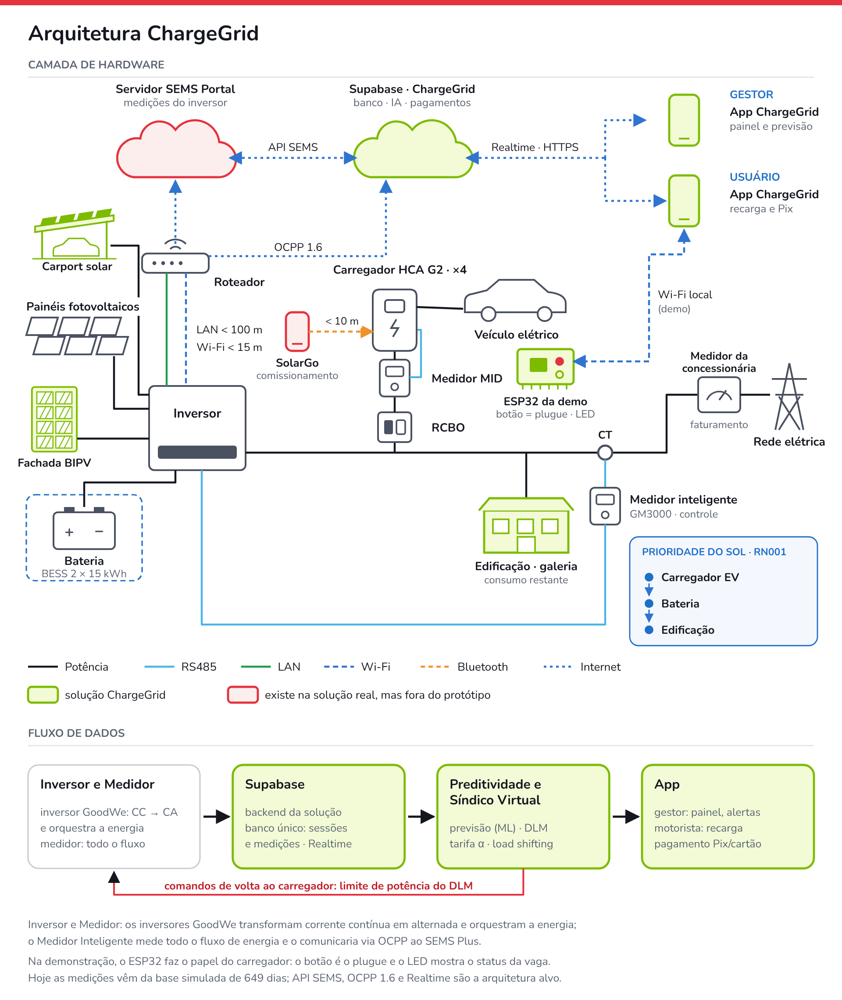

A parte de cima (camada de hardware) mostra os equipamentos da galeria e como cada um se conecta (cor da
linha = tipo de conexão). Em verde-limão está o que é da nossa solução: Supabase, a galeria, o carport solar e a fachada BIPV (que geram para o inversor junto com os painéis), o app
ChargeGrid (gestor e usuário) e o ESP32 da demonstração, que conversa com o app por
Wi‑Fi local. Em vermelho estão a nuvem SEMS Plus e o SolarGo, que existem na solução
real da GoodWe mas não fazem parte do protótipo. A parte de baixo mostra o fluxo de dados em quatro etapas (Inversor e Medidor, Supabase como backend, Preditividade e Síndico Virtual, App), com o comando de
potência do DLM voltando ao carregador.

| Equipamento | Papel no ChargeGrid |
|---|---|
| Inversor GoodWe | Converte a geração das placas (cobertura, fachada BIPV e carport) e da bateria; envia as medições à nuvem SEMS |
| Bateria (BESS, 2 × 15 kWh) | Guarda o sol do meio-dia e descarrega na ponta (17h–21h) |
| RCBO | Proteção de cada vaga |
| Carregador HCA G2 (×4) | Entrega até 7 kW por vaga e fala OCPP 1.6 com o backend |
| Medidor MID | Mede a energia entregue em cada vaga, base da cobrança do motorista |
| Medidor inteligente GM3000 + CT | Mede a importação e a exportação no ponto de conexão; é o que o inversor e o DLM usam para controlar |
| Medidor da concessionária | Medidor oficial da distribuidora: fatura a energia da galeria e registra a injeção da geração. **Não é substituído pelo GM3000** |

**Por que dois medidores na entrada.** O medidor da concessionária é o único com valor
legal para faturamento e compensação da energia injetada (ANEEL, REN 1.000/2021); ele
pertence à distribuidora e não fornece dados em tempo real ao sistema. O GM3000 é um
medidor de controle: lê o mesmo ponto continuamente e informa o inversor e o DLM. Por
isso o CT fica depois de todas as cargas da galeria (vagas e edificação) e antes do
medidor da concessionária.

**Prioridade do sol (RN001).** O excedente solar atende primeiro os carregadores, depois a
bateria e, por fim, a edificação. Na demonstração, o ESP32 faz o papel do carregador: o
botão é o plugue e o LED mostra o status da vaga.

A visão de produto desenhada pela equipe, só com a arquitetura alvo, continua em
[`docs/arquitetura-da-solucao.png`](docs/arquitetura-da-solucao.png).

### 3.1 Princípio: o Supabase é a fonte única de verdade

Na arquitetura alvo, ESP32, motor de inteligência e app **nunca conversam entre si**: todos leem e escrevem no
Supabase. O firmware não decide nada — ele reporta "plugue conectado" e o banco
interpreta. Isso elimina broker MQTT, back-end próprio e lógica de reconciliação entre
dispositivo e nuvem. Em um protótipo de sprint, cada serviço a menos é um ponto de falha
a menos na demonstração.

### 3.2 Fluxo de dados (entradas → processamento → saídas)

Para detalhar o que já roda e o que ainda vai ser ligado, o fluxo está em duas figuras.

**O que roda hoje**

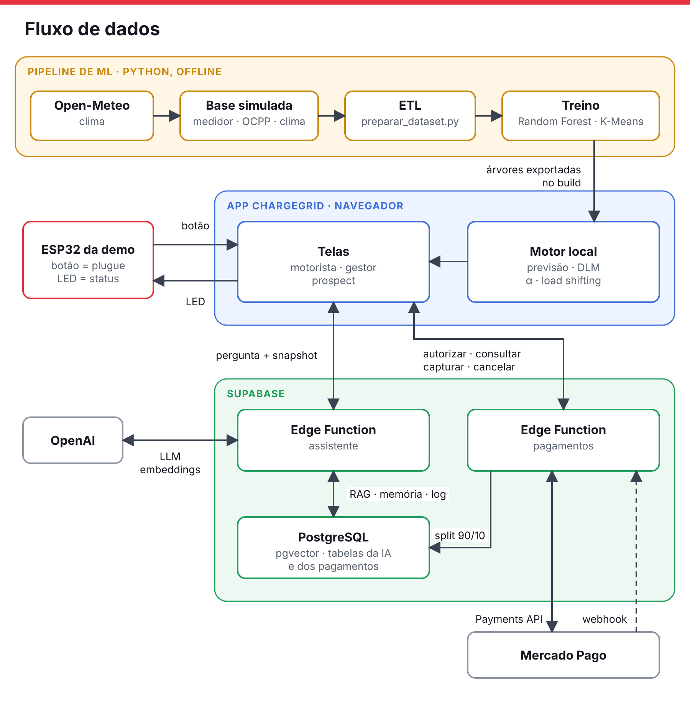

| De → para | O que trafega |
|---|---|
| Treino → motor local | As árvores dos Random Forest, os perfis do K-Means, a previsão do tempo e as métricas, gravados pelo notebook em `app/src/ml/previsao-dados.js` e embutidos no app pelo `build.py` |
| ESP32 → telas | O app lê `GET /button` a cada 400 ms; clique curto = plugue, aperto de 1,5 s = reinício da demo |
| Telas → ESP32 | `GET /led` com a cor e o efeito do estado: azul disponível, âmbar aguardando, verde carregando, vermelho interrompido |
| Telas ⇄ assistente | Pergunta, papel e *snapshot* com os números do modelo de ML; volta a resposta com os metadados do turno. Se a função falhar, o app responde pelas regras locais |
| Telas ⇄ pagamentos | `autorizar`, `consultar`, `capturar` e `cancelar`, com chave de idempotência |
| Assistente ⇄ OpenAI | Chat com *function calling* (`gpt-4o-mini`) e embeddings da pergunta (`text-embedding-3-small`) |
| Assistente ⇄ PostgreSQL | Busca no RAG (`buscar_conhecimento`, pgvector), memória do LangGraph e log em `ia_turnos` e `ia_acoes_sugeridas` |
| Pagamentos ⇄ Mercado Pago | Payments API: cria, consulta, captura, estorna e cancela pagamentos |
| Mercado Pago → pagamentos | Webhook com a mudança de status (por exemplo, Pix pago) |
| Pagamentos → PostgreSQL | `transacoes_pagamento`: valor autorizado e, na captura, valor total, 90% da galeria e 10% da plataforma |

**Arquitetura alvo**

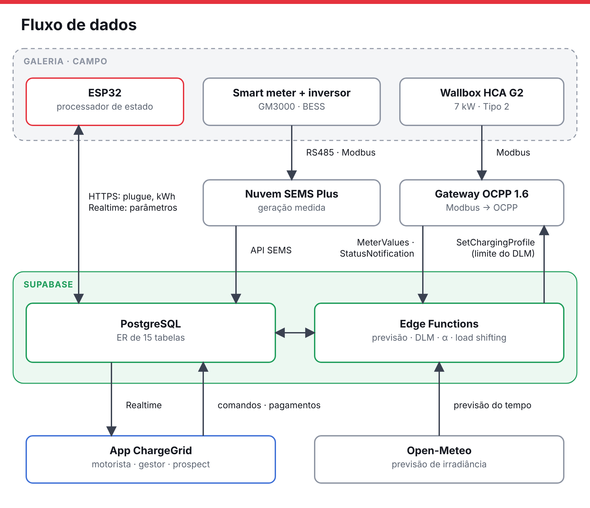

| De → para | O que trafega |
|---|---|
| Smart meter → SEMS | Medição de importação, exportação, geração e bateria via RS485/Modbus e datalogger |
| HCA G2 → gateway | Registros Modbus do carregador |
| ESP32 ⇄ PostgreSQL | O ESP32 envia "plugue conectado" e os kWh a cada 500 ms; recebe os parâmetros da sessão pelo Realtime |
| SEMS → PostgreSQL | O backend consulta a API SEMS e grava a geração **medida**, usada para faturar (RN008) |
| Gateway → Edge Functions | Mensagens OCPP 1.6: `MeterValues`, `StatusNotification`, início e fim de transação |
| Edge Functions → gateway | `SetChargingProfile`: o limite de potência calculado pelo DLM |
| PostgreSQL ⇄ Edge Functions | O motor lê as medições e grava previsões, alertas e alocações de potência |
| PostgreSQL → app | Estado da vaga, da sessão e dos alertas pelo Realtime, sem polling |
| App → PostgreSQL | Comandos do gestor (tarifa base, horários, desativar vaga) e pagamentos |
| Open-Meteo → Edge Functions | Previsão de irradiância e clima, usada para planejar o load shifting |

**Detalhado: APIs, Supabase, ESP32 e frameworks**

Cada linha é um fluxo, lido da esquerda (dispositivo) para a direita (app). Seta cheia é o
que funciona hoje; seta tracejada e caixa de borda tracejada são arquitetura alvo. Em azul,
a linguagem e o framework de cada componente.

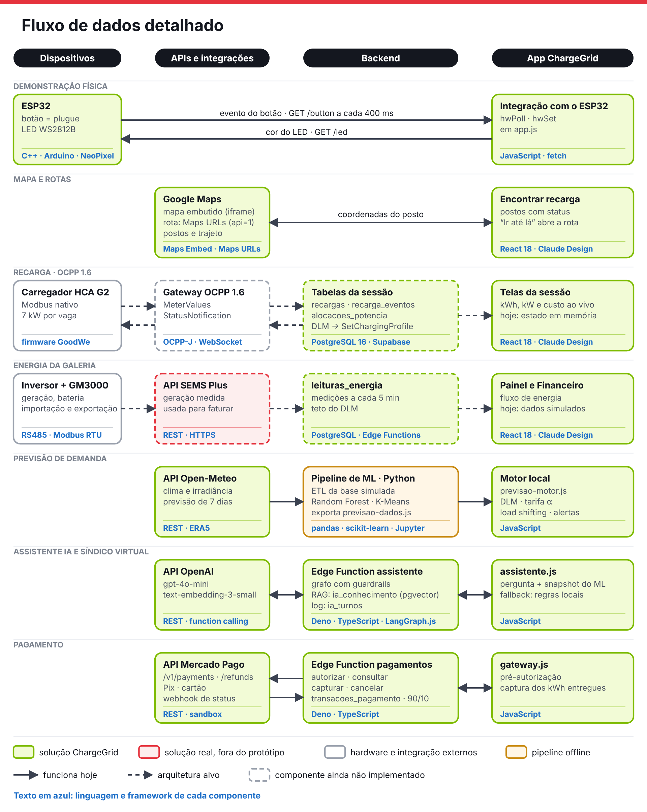

### 3.3 O que é real, o que é simulado

Separar o que roda do que é arquitetura alvo é parte da avaliação honesta da solução.

| Componente | Situação na Sprint 4 | Onde está |
|---|---|---|
| App v2 — 3 personas, mais de 40 telas | ✅ Funcional, abre offline | [`app/`](app/) |
| Previsão de demanda (ML) | ✅ Treinado e **rodando dentro do app** (paridade Python × JS testada) | [`inteligencia/`](inteligencia/), [`app/src/ml/`](app/src/ml/) |
| Síndico Virtual e Assistente IA | ✅ Edge Function com LangGraph + OpenAI + RAG (pgvector), 12 testes offline; no app, fallback para regras locais se a API cair | [`supabase/functions/assistente/`](supabase/functions/assistente/) |
| Pagamento (Pix, cartão, créditos) | ✅ Edge Function com Mercado Pago **sandbox**: pré-autorização, captura parcial, estorno e split 90/10 | [`supabase/functions/pagamentos/`](supabase/functions/pagamentos/) |
| Banco Supabase | 🟡 Migrations da IA e dos pagamentos prontas; ER de 15 tabelas modelado e testado em PostgreSQL 16 local com a base simulada; Realtime ainda não ligado ao app | [`supabase/migrations/`](supabase/migrations/), [`banco-de-dados/`](banco-de-dados/) |
| Ciclo físico botão → medição → LED | ✅ Funcional, por HTTP direto na rede local do ESP32, tanto na v1 quanto no app v2 | [`demo-fisica/`](demo-fisica/), `hwPoll`/`hwSet` em [`app/src/app.js`](app/src/app.js) |
| Dados de medição | 🟡 **Base simulada** de 649 dias calibrada para São Paulo, com os defeitos de telemetria real | [`inteligencia/dados/`](inteligencia/dados/) |
| API SEMS e gateway Modbus→OCPP | ⏳ Não implementados (dependem de acesso a uma planta real) | — |

### 3.4 Uma recarga de ponta a ponta

Sequência real do código: `startSession`, `esperarPix`, `iniciarCarga` e `finishSession`
em `app/src/app.js`, e `supabase/functions/pagamentos/index.ts`. Seta cheia é chamada; seta tracejada é resposta ou aviso assíncrono.

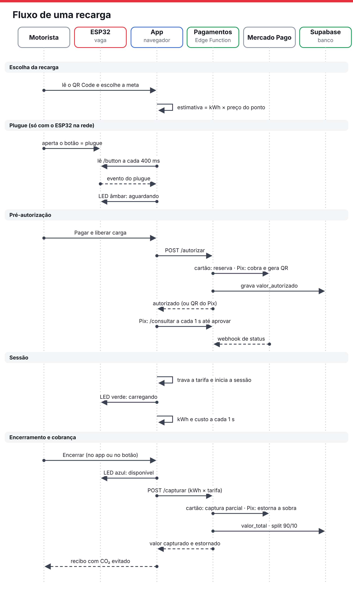

| Etapa | O que acontece |
|---|---|
| Escolha | O motorista lê o QR Code e escolhe a meta por tempo, kWh ou km. O app estima o valor (kWh da meta × preço do ponto) |
| Plugue | Só com o ESP32 na rede: o botão físico é o plugue, e sem ele o app não libera a carga. O LED fica âmbar |
| Pré-autorização | **Cartão:** reserva o valor (`capture: false`). **Pix:** cobra a estimativa e gera o QR; o app consulta a cada 1 s até aprovar. **Créditos:** reserva interna, sem passar pelo Mercado Pago. O webhook atualiza o status no banco em paralelo |
| Sessão | A tarifa é gravada na sessão (não muda mais) e o LED fica verde. A meta atingida para a contagem, mas não encerra nem cobra |
| Encerramento | A cobrança só acontece quando o motorista encerra (no app ou no botão). **Cartão:** captura parcial. **Pix:** estorno da sobra. **Créditos:** débito do valor final. O split 90/10 é gravado e o recibo mostra o CO₂ evitado |

As figuras são geradas por `docs/diagramas/build.py`; para alterar, edite o script e rode
`python3 build.py && python3 finalize.py fluxo-*.svg && python3 check.py fluxo-*.svg && python3 check2.py fluxo-*.svg && python3 render.py fluxo-*.svg` (os dois `check` apontam sobreposições de texto, setas e números).

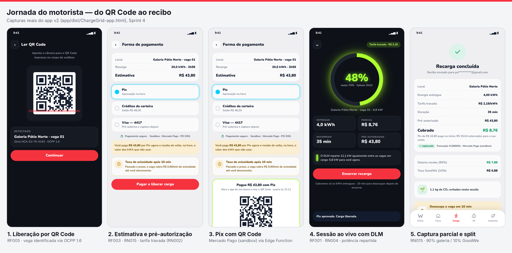

### 3.5 Arquitetura de navegação das personas

Um app, três personas. A escolha de papel separa o motorista do gestor; no gestor, ter ou
não a solução instalada leva ao painel completo ou ao modo de avaliação (prospect). Cada
prancha mostra a barra de abas e, abaixo de cada aba, as telas que se abrem a partir dela.
As quatro pranchas também estão em [`docs/navegacao-personas.pdf`](docs/navegacao-personas.pdf).

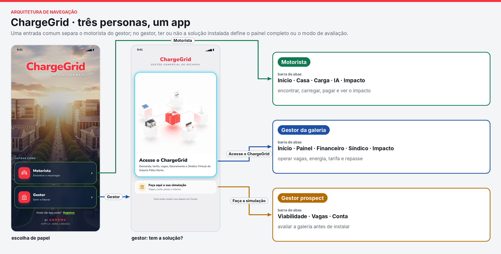

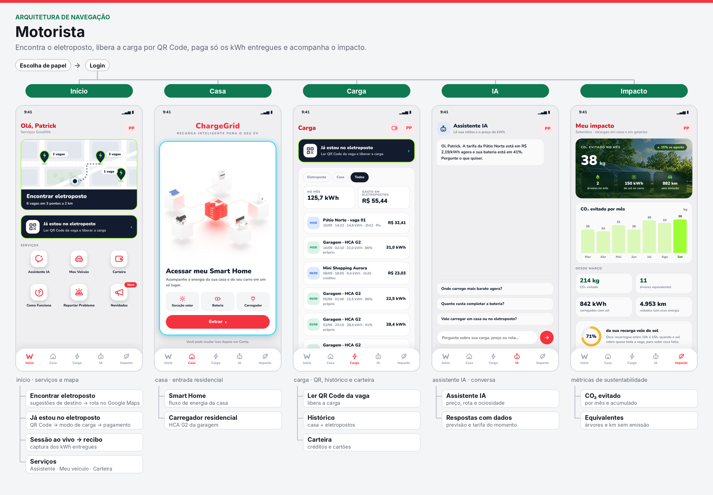

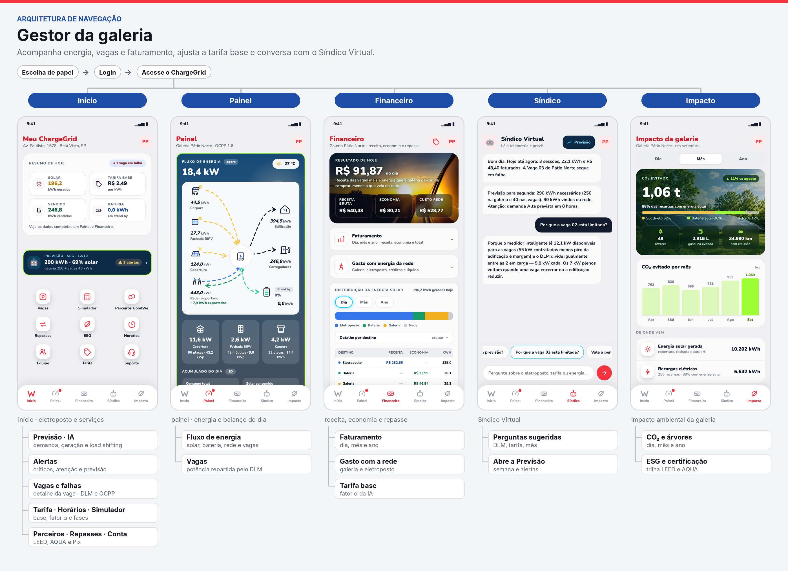

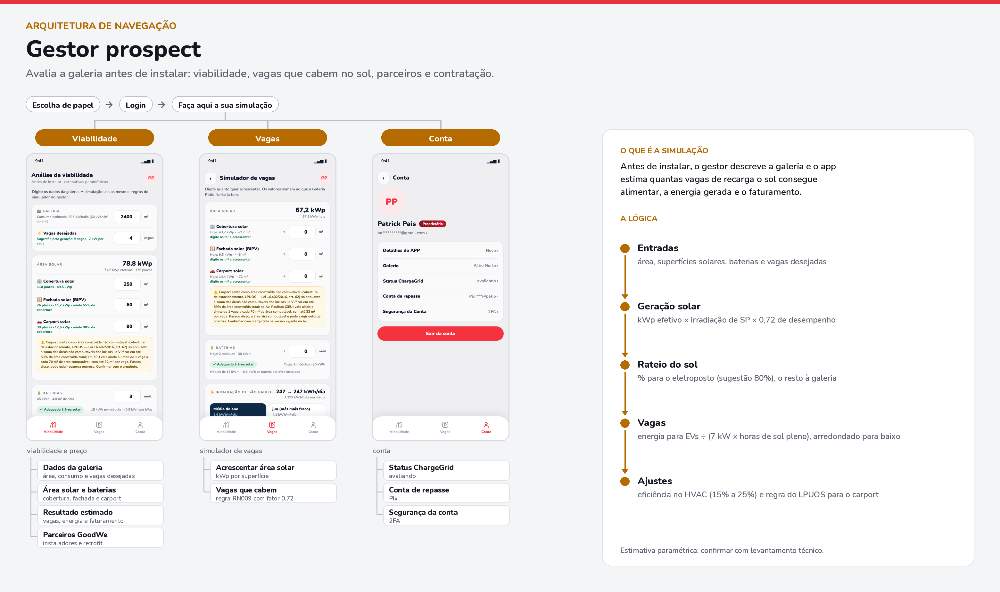

---

## 4. Como cada parte resolve o desafio

### 4.1 Controle de demanda (DLM) — RF001, RN004

A demanda contratada da galeria é de **55 kW**. O teto disponível para as vagas é
recalculado pelo perfil horário da edificação:

```
teto_vagas = 55 kW − pico previsto da edificação − 12% × 55 kW
potência por vaga = min(7 kW, teto_vagas × 0,96 ÷ vagas em carga)
```

Um limiar fixo ou dispara alerta à toa, ou deixa a galeria ultrapassar a contratada e
pagar multa. Na tela da sessão o motorista vê *"O DLM reparte 12,1 kW igualmente entre
as vagas em carga: 5,8 kW para você agora"*, e o gestor pergunta ao Síndico *"Por que a
vaga 02 está limitada?"* e recebe a conta aberta. Potência reduzida aparece em âmbar,
não em vermelho: o DLM agindo não é erro, é a galeria protegendo o disjuntor.

> **No protótipo, o DLM informa mas ainda não limita.** O cálculo e a mensagem estão
> certos, mas a sessão simulada continua somando energia a 6,8 kW fixos. Ligar o
> resultado do DLM ao ritmo da sessão (e, no alvo, ao `SetChargingProfile` do OCPP) é
> uma pendência listada em 8.3.

### 4.2 Protocolos abertos — RF002, RNF004

Toda a telemetria das vagas usa as mensagens do **OCPP 1.6**: `StartTransaction`,
`StopTransaction`, `MeterValues` (`Energy.Active.Import.Register`,
`Power.Active.Import`) e `StatusNotification` (`Available`, `Charging`, `Faulted` +
`errorCode`). A tela de detalhe da vaga mostra o payload e a tradução humana — por
exemplo, `Faulted · GroundFailure` vira *"falha de aterramento, vaga despublicada do
mapa automaticamente"*. O app e o banco já falam OCPP; falta o gateway que traduz o
Modbus nativo do HCA G2, que depende de hardware.

### 4.3 Tarifação dinâmica e pagamento — RF003, RF015, RF018, RN002, RN014, RN015

**O gestor define a tarifa base; a IA aplica o fator α.**

| Condição | Efeito em α |
|---|---|
| Excedente solar alto | −12% |
| Solar baixo / nublado | +4% |
| Horário de ponta da concessionária (17h–21h) | +18% |
| Demanda concorrente na galeria | exibida como fator; neutra no cenário padrão |

O gestor mantém o controle do ROI (a base), e a IA assume o que é operacionalmente
complexo (clima, tarifa horossazonal, balanceamento). O **desconto solar desloca
recargas para as horas de sol sobrando**, o que é ao mesmo tempo receita e
sustentabilidade.

**O preço trava na liberação da carga** (`recargas.preco_kwh_aplicado`): uma mudança
de tarifa nunca reprecifica uma sessão em curso. No protótipo o preço fica gravado
quando o pagamento é aprovado e a carga começa, logo depois do plugue físico.

> **No protótipo, o α ainda não chega ao motorista.** A tela *Tarifa* do gestor calcula
> base × α (R$ 2,49 × 1,00 no cenário padrão), mas o preço cobrado do motorista vem fixo
> do cadastro do ponto (R$ 2,19 na Pátio Norte). Na base simulada de 12 meses o α foi
> aplicado (seção 7.3); no app, ligar as duas telas é uma pendência listada em 8.3.

**Pagamento em duas fases (RN015):** pré-autoriza o valor estimado da meta e, no fim,
captura só os kWh entregues. No teste da captura de tela: R$ 43,80 pré-autorizados,
4,00 kWh entregues × R$ 2,19 = **R$ 8,76 cobrados** e **R$ 35,04 estornados** no Pix;
R$ 7,88 para a galeria e R$ 0,88 para a plataforma. App e QR Code substituem o cartão
RFID, o que elimina o limite de cartões por carregador.

### 4.4 IA como motor lógico — RF010, RF016, RN007, RN008

| Pergunta de negócio | Técnica | Onde a resposta aparece |
|---|---|---|
| Quanto a galeria vai consumir em cada hora dos próximos 7 dias? | Random Forest regularizado (60 árvores) | Tela Previsão, alertas, Síndico |
| Quanto as vagas vão entregar em cada hora? | Random Forest **relativo ao nível** (aprende o formato do dia e escala pelo nível das últimas semanas, porque árvore não extrapola o crescimento da frota) | Tela Previsão |
| A hora terá demanda Baixa, Média ou Alta na rede? | Random Forest com `class_weight="balanced"` | Alertas "demanda Alta prevista" |
| Que tipo de dia é hoje? | K-Means (k = 3) | Card "Perfil do dia" |
| Vale comprar energia de madrugada, puxar recarga para o sol ou ampliar a bateria? | Balanço energético hora a hora sobre a previsão | Banner de load shifting e decisões do Síndico |
| Por que esse número? | Contrafactual no modelo (efeito de cada fator) | "Por que esse número" |

A previsão usa a **irradiância da Open-Meteo para planejar** (load shifting) e a
**geração medida pelo SEMS Plus para faturar**, como pede a RN008. As árvores
treinadas em Python são exportadas para JavaScript e rodam **dentro do app**, sem
servidor; um teste de paridade garante que as duas implementações dão a mesma resposta.

### 4.5 Síndico Virtual e Assistente IA — RF008, RF016

Leva para o produto a arquitetura da Sprint 03 da matéria de IA, agora no Supabase:

- **LangGraph.js** com os nós `guardrail_entrada → recuperar (RAG) → agente → ferramentas → guardrail_saida`;
- **RAG no pgvector** com o manual do HCA G2, documentos do desafio e o FAQ do app, filtrado por papel;
- **Ferramentas (function calling)** que consultam os números do modelo de ML, do balanço de energia, das vagas e da tarifa — o LLM **não inventa número**;
- **Memória por conversa** no checkpointer Postgres do LangGraph;
- **Guardrails** contra prompt injection, aconselhamento jurídico/financeiro e LGPD (máscara de CPF, placa e e-mail);
- **Ações só como sugestão**: o que a IA propõe vai para `ia_acoes_sugeridas` e o gestor confirma.

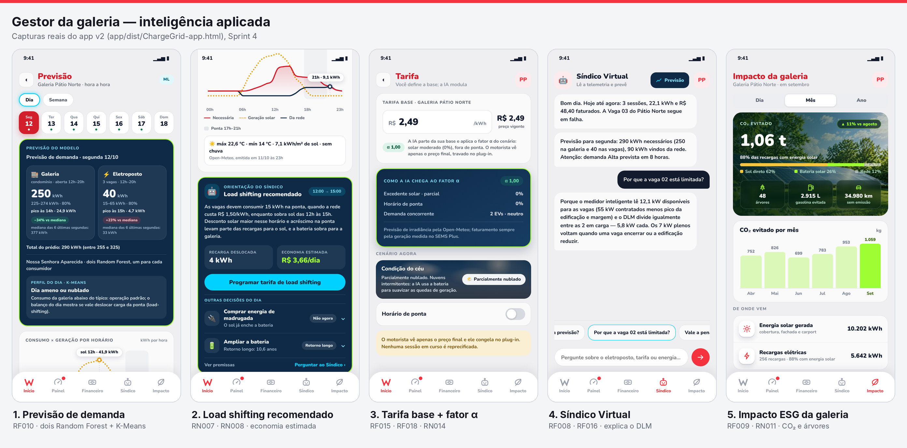

### 4.6 Simulador de viabilidade e funil comercial — RF012, RN009, RN010, RN006

O **gestor prospect** simula, antes de comprar, quantas vagas cabem na geração solar:

```
Vagas = ⌊(kWp × irradiação de SP × 0,72 × % para EVs) ÷ 7 kW⌋
```

com fachada BIPV rendendo 55% e carport 90% da cobertura, a regra do LPUOS (Lei
16.402/2016) para carport em São Paulo, o efeito de eficiência energética em HVAC
(15% a 25%) e o aviso de que a estimativa é paramétrica. Do resultado ele chega a
**instaladores e parceiros GoodWe** e à trilha **LEED/AQUA** — o eletroposto comercial
vira porta de entrada para a solução residencial (Smart Home na aba **Casa**).

---

## 5. Tecnologias GoodWe e por que cada uma

| Tecnologia GoodWe | Papel no ChargeGrid | Por que essa escolha |
|---|---|---|
| **Wallbox HCA G2 (7 kW, Tipo 2)** | Carregador de cada vaga | É o produto do desafio; 7 kW monofásico é a potência certa para a permanência típica num shopping (~95 min) |
| **Smart meter (GM3000) + inversor** | Medição a cada 5 min da importação, exportação, geração por superfície e bateria | Sem medidor não existe DLM: é ele que diz quanto sobra da demanda contratada |
| **SEMS / SEMS Plus** | Fonte da geração **medida**, usada para faturar | Separa planejamento (previsão) de faturamento (medição), exigência da RN008 |
| **BESS (2 × 15 kWh)** | Achata o pico na ponta e guarda o sol do meio-dia | Na base simulada, 40% da energia importada da rede cai na ponta: é exatamente onde a bateria rende |
| **Geração solar em cobertura, fachada BIPV e carport (67,2 kWp)** | Energia limpa para vagas e condomínio | O carport gera onde estão os carros e protege a vaga; a fachada aproveita área vertical em lote urbano |

O **LED do carregador e a cor do app são a mesma coisa** (azul disponível, verde
carregando, vermelho falha — RNF001): quem olha o poste e depois o celular vê o mesmo
estado. Nenhum estado depende só de cor: todos saem com ícone e texto.

---

## 6. Alinhamento ao desafio GoodWe e à disciplina

### 6.1 Critérios da mentoria GoodWe

| Critério da mentoria | Como o ChargeGrid atende |
|---|---|
| Arquitetura funcional (data flow) | Seção 3: entradas (medidor, OCPP, clima), processamento (ETL, ML, motor) e saídas (app, alertas, pagamento) |
| IA como motor lógico | A IA decide preço (α), potência (DLM com previsão), compra de energia (load shifting) e explica cada decisão |
| Aderência ao contexto | Galeria na Av. Paulista, clima de São Paulo, frota brasileira de EVs, tarifa horossazonal, ANEEL 1.000/2021, LPUOS |
| Visão de produto real | Pagamento com API real (sandbox), split 90/10, recibo, taxa de ociosidade, repasse por Pix |
| Gestão e estrutura de dados | ER de 15 tabelas, base OCPP/medidor com defeitos reais tratados por ETL auditável |

### 6.2 Customer Experience Management

| Conteúdo da disciplina | Aplicação no ChargeGrid |
|---|---|
| **Cap. 1 — Estratégias de CX e cultura customer centric** | O preço e a potência vêm sempre com uma linha de justificativa. Número sem razão é caixa-preta, e em produto de energia isso vira desconfiança no preço |
| **Cap. 2 — Jornada do cliente, omnichannel e UX** | A jornada do motorista foi desenhada em etapas (encontrar → chegar → plugar → acompanhar → pagar → recibo) e une recarga em casa e na galeria num só histórico. Telas de entrada, login, impacto, financeiro e mapa revisadas nesta sprint |
| **Cap. 3 — Processo de decisão e neuromarketing** | Redução de incerteza antes de plugar (estimativa de tempo e valor, tarifa travada), ancoragem no desconto solar, reforço positivo com CO₂ evitado e árvores equivalentes no recibo |
| **Cap. 4 — CRM, funil de vendas e customer care** | Persona **gestor prospect** como topo de funil (simulador → parceiros → contratação), favoritos e notificação de vaga livre como régua de relacionamento, Síndico Virtual e Assistente IA como atendimento 24h |
| **Cap. 5 — Métricas de CX** | Avaliação por estrelas ao fim de cada recarga, KPIs de receita, economia e gasto com a rede no Financeiro, métricas ESG como métrica de sucesso do cliente (o gestor usa no marketing da galeria) |

### 6.3 Outras disciplinas do curso refletidas no repositório

- **Engenharia de Software** — requisitos RF/RNF/RN rastreados até o código em [`docs/rastreabilidade-requisitos.md`](docs/rastreabilidade-requisitos.md); modelo ER; design system com tokens e 9 componentes.
- **Machine Learning aplicado a dados de energia** — o notebook segue o roteiro das aulas: análise exploratória, divisão temporal 80/20, comparação de Regressão Linear/Logística, KNN e Random Forest, escolha justificada pelas métricas.
- **Inteligência Artificial (Sprint 03)** — LangGraph, RAG, memória, guardrails e avaliação, portados para produção no Supabase.
- **IoT / sistemas embarcados** — ESP32 com fita WS2812B e botão físico, debounce por evento ao soltar, polling de 400 ms.

---

## 7. Resultados quantitativos e qualitativos

> Todos os números desta seção saem de arquivos do repositório e foram recalculados para
> esta documentação. A base é **simulada**: não houve medição de uma galeria real. Os
> números provam que a cadeia dados → ETL → modelo → app funciona e mostram a ordem de
> grandeza dos ganhos; não são medição de campo.

### 7.1 Qualidade dos dados (ETL)

A base de 01/01/2025 a 11/10/2026 imita o que chegaria do smart meter e do OCPP,
**com os defeitos de telemetria real**: lacunas do datalogger, leituras espúrias,
retransmissões duplicadas, troca de medidor, `MeterValues` perdidos e
`StopTransaction` que nunca chegou.

| Indicador (`inteligencia/dados/qualidade_dados.json`) | Resultado |
|---|---|
| Leituras do medidor processadas | 185.926 |
| Duplicatas e leituras espúrias removidas | 556 e 82 |
| `MeterValues` interpolados / duplicados removidos | 3.855 / 294 |
| Sessões sem `StopTransaction` fechadas pelo último `MeterValue` | 13 |
| Erro do ETL no total da galeria vs. gabarito | **0,005%** |
| Erro do ETL no total das vagas vs. gabarito | **−0,044%** |
| Horas com o número de vagas operando correto | **99,56%** |

### 7.2 Desempenho dos modelos (conjunto de teste, divisão temporal 80/20)

| Modelo | Métrica | Resultado | Referência ingênua |
|---|---|---|---|
| Galeria — Random Forest regularizado | R² · MAE | **0,961** · 1,27 kWh/h | média das 4 semanas: 0,935 · 1,66 |
| Galeria — erro do total diário | MAPE diário | **6,1%** | 8,4% |
| Eletroposto — Random Forest relativo ao nível | R² · MAE | **0,360** · 1,96 kWh/h | 0,283 · 2,05 |
| Eletroposto — erro do total diário | MAPE diário | **37,1%** | 39,9% |
| Eletroposto — erro do total semanal | MAPE semanal | 14,0% | **12,4%** (a referência ganha) |
| Classificação de demanda Baixa/Média/Alta | F1 macro | **0,656** · nenhuma hora Alta prevista como Baixa | RF sem balanceamento: 0,618 |
| Clustering de dias | Silhouette (k = 3) | 0,326 | — |
| Paridade Python × JavaScript | Maior diferença | **0,00005 kWh** | limite do teste: 0,0001 |

**Leitura honesta.** O consumo da galeria é previsível e o erro diário de 6% está na
faixa típica de prédio comercial. O eletroposto, com ~6 sessões por dia, é quase
aleatório no total diário: nenhum método erra menos de ~37%, e na soma da semana a
média simples é melhor que o modelo. O valor da previsão nas vagas está na **curva
hora a hora** (planejar rede e bateria), não no total exato.

### 7.3 Balanço energético e financeiro de 12 meses (12/10/2025 a 11/10/2026)

| Indicador | Valor |
|---|---|
| Geração solar (67,2 kWp) | **90,3 MWh/ano** (≈ 1.344 kWh/kWp) |
| Sol consumido no próprio local (não exportado) | **94,8%** |
| Consumo atendido sem importar da rede (galeria + vagas) | **47,4%** |
| Energia importada na ponta (17h–21h) | 40% de toda a importação da rede |
| Maior pico de 15 min na rede | **54,2 kW** — nunca acima dos 55 kW contratados |
| Horas acima do teto operacional (48,4 kW) em que o DLM precisou agir | 58 h |
| Recargas · energia entregue | 2.108 sessões · **19,0 MWh** (≈ 9,0 kWh/sessão) |
| Tarifa média aplicada (base × α) | R$ 2,17/kWh (faixa R$ 1,84 a R$ 2,58) |
| Receita das vagas | **R$ 41.323/ano** → R$ 37.191 galeria (90%) · R$ 4.132 plataforma (10%) |

### 7.4 Testes automatizados

| Teste | Resultado |
|---|---|
| `node --test supabase/functions/assistente/testes/nos.test.ts` (nós do grafo e guardrails, offline) | **12/12 aprovados** |
| `python3 inteligencia/testar_paridade_js.py` (modelo Python × motor do app, inclusive com dados ausentes) | **PARIDADE OK** |
| `avaliacao/avaliar.ts` (14 casos de conversa × N modelos de LLM) | pronto; precisa da chave da OpenAI para rodar |

### 7.5 Resultados qualitativos

- **O motorista sabe quanto vai pagar antes de plugar** e paga só o que recebeu — a
  maior fonte de atrito em recarga pública (cobrança surpresa) deixa de existir.
- **O gestor entende o que a IA decidiu.** Toda saída — fator α, potência limitada,
  load shifting, ampliar bateria — vem com o porquê em uma linha.
- **Uma pessoa pode ser motorista e anfitrião.** No modelo de dados o papel é relação,
  não coluna: o condômino que aluga a própria vaga é o caso de uso natural.
- **Falha vira ação.** `Faulted · GroundFailure` aparece como alerta crítico com
  "reiniciar remotamente" e a vaga sai do mapa sozinha.

---

## 8. Avaliação crítica: sustentabilidade e inovação

### 8.1 Benefícios de sustentabilidade

**Estimativa de CO₂ evitado em 12 meses** (base simulada; premissas explícitas para
quem quiser refazer a conta):

| Parcela | Conta | tCO₂/ano |
|---|---|---|
| Sol consumido no local em vez da rede | 85,6 MWh × 0,0385 tCO₂/MWh (fator médio do SIN em 2023, MCTI) | ≈ 3,3 |
| Quilômetros elétricos em vez de gasolina | 19,0 MWh ÷ 0,17 kWh/km ≈ 112 mil km; carro a gasolina a 11 km/L ≈ 10,2 mil L de gasolina C (E30, 70% fóssil × ~2,2 kg CO₂/L) | ≈ 15,7 |
| Menos: emissão da energia de rede nas recargas (pior caso, 100% da rede) | 19,0 MWh × 0,0385 | ≈ −0,7 |
| **Total** | | **≈ 18 tCO₂/ano** (≈ 830 árvores a 22 kg/ano) |

Como a matriz elétrica brasileira já é limpa, **o ganho grande vem da eletrificação
dos quilômetros**, não da troca de rede por sol. O solar pesa mais no bolso (energia
de ponta evitada) do que no carbono — e isso deveria ser dito ao gestor.

Além do carbono:

- **Rede elétrica:** o DLM e a bateria seguram a galeria abaixo da contratada sem
  ampliar a entrada de energia — investimento evitado em infraestrutura.
- **Eficiência:** o desconto solar e o load shifting puxam consumo para quando há sol
  sobrando; 94,8% da geração é aproveitada no local.
- **Social:** recarga pública com preço transparente em local de permanência
  (compras, serviços), para motoristas sem garagem própria.

### 8.2 Diferenciais inovadores

| Diferencial pedido no enunciado | No ChargeGrid |
|---|---|
| Algoritmos inteligentes | Random Forest relativo ao nível, classificador balanceado, K-Means, contrafactual explicativo |
| Automações avançadas | DLM dinâmico, fator α, recomendação e programação de load shifting, vaga em falha despublicada |
| Interface amigável | Design system próprio, status com cor + ícone + texto, justificativa em toda saída de IA |
| Visualização de dados | Consumo × geração hora a hora, de onde vem a energia, pico vs. teto do DLM, ESG |
| Assistente virtual | Síndico Virtual e Assistente IA com LLM, RAG, ferramentas e guardrails |

### 8.3 Limitações e o que faríamos a seguir

Avaliação crítica significa dizer também o que ainda não está bom:

1. **Dados simulados.** O caminho para dados reais é um export do SEMS de uma planta
   comercial (pedido na mentoria) e o clima real por `baixar_clima_real.py`; o ETL,
   o modelo e o app não mudam.
2. **O motor ainda roda no cliente.** DLM, α e load shifting devem migrar para Edge
   Functions, com o app lendo `previsoes` e `alertas_sindico` pelo Realtime
   ([`inteligencia/supabase/previsao_schema.sql`](inteligencia/supabase/previsao_schema.sql)).
3. **ESP32 ainda fala HTTP direto com o app.** O app v2 consulta o botão e muda o LED
   pela rede local do ESP32. Fazer o ESP32 escrever no Supabase e o app ler pelo Realtime
   fecha a arquitetura alvo.
4. **α e DLM ainda não comandam a sessão do motorista.** O preço do motorista é o do
   cadastro do ponto, não base × α, e a sessão simulada soma energia a 6,8 kW fixos,
   mesmo quando o DLM anuncia 5,8 kW. O valor capturado também é calculado no app; no
   alvo, deve sair dos `MeterValues` gravados no banco.
5. **Fator α por faixas, não por otimização.** O requisito RF018 pede o ponto ótimo de
   preço; hoje α é uma regra explicável. O dado de elasticidade ao preço já está na base
   simulada e permite estimar a curva de demanda e otimizar.
6. **Fatores de CO₂ divergentes entre telas.** O simulador usa 0,0817 tCO₂/MWh, a tela
   de impacto usa 0,0385 e o recibo usa outro fator por kWh. Precisa de um fator único,
   versionado e com fonte.
7. **Requisitos ainda não atendidos:** prioridade para bateria crítica (RN003, SOC < 10%),
   ranking ESG (RF009) e relatório semanal no Financeiro (RF007). O estado de cada
   requisito está na [matriz de rastreabilidade](docs/rastreabilidade-requisitos.md).
8. **Segurança da demonstração.** O firmware usa rede aberta e CORS liberado; a tela de
   login é navegação, não autenticação (Supabase Auth é o próximo passo).

---

## 9. Referências: frameworks, ferramentas, linguagens e sensores

| Camada | Tecnologias |
|---|---|
| **Linguagens** | JavaScript, TypeScript, Python, SQL (PostgreSQL), C++ (Arduino) |
| **App** | React 18 (runtime do Claude Design), HTML/CSS, fonte Nunito local, build em Python |
| **Backend** | Supabase: PostgreSQL 16, pgvector, Edge Functions (Deno), Row Level Security, Secrets |
| **IA generativa** | LangGraph.js, OpenAI `gpt-4o-mini` e `text-embedding-3-small`, checkpointer Postgres |
| **Machine learning** | scikit-learn (Random Forest, KNN, Regressão Linear/Logística, K-Means), pandas, NumPy, Matplotlib, Jupyter; Orange (fluxo alternativo em `inteligencia/orange/`) |
| **Pagamento** | API do Mercado Pago (Payments, captura parcial, estorno, webhook), Pix BR Code |
| **Dados externos** | Open-Meteo (previsão e histórico ERA5), Google Maps (mapa embutido e rotas via Maps URLs) |
| **Hardware e sensores** | ESP32, fita LED WS2812B (Adafruit NeoPixel), botão físico; no contexto real, smart meter GoodWe GM3000, inversor e BESS via RS485/Modbus |
| **Protocolos e normas** | OCPP 1.6, Modbus RTU, HTTPS/WebSocket, ANEEL REN 1.000/2021, LGPD, LPUOS SP (Lei 16.402/2016), LEED e AQUA |

**Fontes externas usadas nos cálculos**

- MCTI — fator médio de emissão do SIN em 2023 (38,5 kgCO₂/MWh): [O Setor Elétrico](https://www.osetoreletrico.com.br/?p=159478)
- Fatores mensais do SIN em 2025 (21–29 kgCO₂/MWh), tendência de queda: [Canal Solar](https://canalsolar.com.br/emissoes-de-co%e2%82%82-geracao-eletrica-mcti/)
- Gasolina E30 (30% de etanol anidro) nos postos: [Localiza — Gasolina E30](https://seminovos.localiza.com/blog/posts/gasolina-e30-o-que-muda)
- Normais climatológicas de São Paulo (INMET 1991–2020), usadas na calibração do clima simulado

---

## 10. Estrutura do repositório e como rodar

```
Challenge_Goodwe/
├── app/                 App v2 (motorista, gestor, prospect) · src/ml · src/ia · src/pagamento
├── inteligencia/        Base simulada, ETL, notebook de ML, exportação para o app
├── supabase/            Migrations, Edge Functions (assistente, pagamentos), RAG
├── banco-de-dados/      Modelo ER de 15 tabelas (mermaid + schema.sql)
├── demo-fisica/         v1: ESP32 + interface servida pelo microcontrolador
├── design-system/       Tokens e 9 componentes
└── docs/                Arquitetura, capturas de tela, rastreabilidade, roteiro do vídeo
```

### App

```bash
# Arquivo único, sem servidor e sem internet:
abrir app/dist/ChargeGrid-app.html

# Ou, em desenvolvimento:
cd app && python3 -m http.server 8000   # http://localhost:8000
```

Roteiro de teste: **Motorista** → *Já estou no eletroposto* → *Continuar* → modo
**kWh** → *Pagar e liberar carga* (Pix) → *Encerrar recarga* → recibo com captura
parcial. Depois **Gestor** → card *Previsão* → *Síndico* → *Tarifa* → *Simulador* → *Impacto*.

Assistente IA e pagamentos chamam as Edge Functions quando as props `iaModo` e
`pagamentoModo` estão em `api`; sem rede ou sem chave, o assistente responde pelas
regras locais e o pagamento pode ser posto em `sandbox` (simulação no navegador).

### Machine learning

```bash
cd inteligencia
pip install numpy pandas scikit-learn matplotlib
python3 gerar_base_simulada.py && python3 preparar_dataset.py
python3 executar_notebook.py ChargeGrid_ML.ipynb && python3 testar_paridade_js.py
cd ../app && python3 build.py
```

### Supabase

```bash
cp .env.example .env                       # chaves NUNCA vão para o Git (RNF003)
npx supabase db push                       # migrations da IA e dos pagamentos
python supabase/scripts/ingerir_conhecimento.py
npx supabase secrets set OPENAI_API_KEY=... MP_ACCESS_TOKEN=TEST-...
npx supabase functions deploy assistente
npx supabase functions deploy pagamentos --no-verify-jwt
```

### Demonstração física

Monte a fita WS2812B e o botão conforme [`demo-fisica/firmware/README.md`](demo-fisica/firmware/README.md),
grave `esp32-led-demo.ino`, conecte o celular na rede `GoodWe-Demo` e abra `http://192.168.4.1/`.

---

## Decisões técnicas registradas

- **Supabase como fonte única de verdade**, não como "um banco": nenhum componente fala com outro diretamente.
- **Cor de status = cor do LED físico**; o vermelho da marca é o vermelho da falha, por isso nenhum estado depende só de cor.
- **DLM com margem, não com limiar fixo.**
- **Potência reduzida em âmbar, não em vermelho.**
- **Toda saída de IA vem com uma linha de justificativa.**
- **O botão físico é o plugue, não um controle:** clique curto conecta, aperto longo de 1,5 s reinicia a demonstração.
- **Papel é relação, não coluna:** a mesma pessoa pode ser motorista e anfitrião.
- **Chaves só no servidor:** a da OpenAI e a do Mercado Pago ficam em `supabase secrets`; o app só conhece a chave pública (anon).

## Versões

- **`v1.0`** — fim da Sprint 3 (demonstração física, app v2, modelo de dados, design system).
- **`main`** — Sprint 4: backend Supabase, assistente IA, previsão de demanda e pagamentos.

## Licença

Código sob [licença MIT](LICENSE). As bibliotecas em `app/vendor/` mantêm suas próprias
licenças ([`app/vendor/LICENSES.md`](app/vendor/LICENSES.md)). GoodWe, SEMS e HCA G2 são
marcas de seus titulares. Trabalho acadêmico do EV Challenge GoodWe + FIAP 2026, não é
produto oficial da GoodWe.
