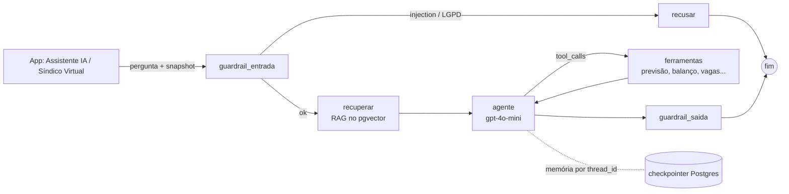

# Edge Function `assistente` — chatbot do motorista e Síndico Virtual

Leva para o app a arquitetura da Sprint 03 da matéria de IA (LangGraph + RAG + memória +
guardrails + avaliação), agora rodando no Supabase e com **ferramentas** que consultam os
números do app (previsão de ML, balanço de energia, vagas, tarifa).



## O que mudou em relação à Sprint 03

| | Sprint 03 (terminal) | App (Supabase) |
|---|---|---|
| Orquestração | LangGraph em Python | LangGraph.js na Edge Function (`grafo.ts`), mesmos nós |
| Memória | `MemorySaver` (some ao reiniciar) | Checkpointer Postgres do LangGraph no banco do Supabase, por `thread_id` |
| RAG | `InMemoryVectorStore` refeito a cada execução | `pgvector` (`ia_conhecimento`), carregado uma vez pelo `ingerir_conhecimento.py`, filtrado por papel |
| Dados do negócio | Não acessava (P9 e P10 do notebook ficavam sem resposta) | **Ferramentas** com os números do modelo de ML e da operação; o LLM não inventa número |
| Perfis | Um prompt para 5 perfis | Persona do motorista e do Síndico, com ferramentas diferentes |
| Guardrails | Injection + jurídico/financeiro | Os mesmos + LGPD (dados de terceiros), máscara de CPF/placa/e-mail e ações só como sugestão |
| Log | `conversas_chatbot.jsonl` | Tabela `ia_turnos` (guardrail, ferramentas, fontes, latência, tokens), com RLS |
| Testes | `test_cases.py` + `compare_models.py` | `testes/nos.test.ts` (offline) + `avaliacao/avaliar.ts` (14 casos, N modelos) |

## Arquivos

```
supabase/
  migrations/20261012000000_assistente_ia.sql   pgvector, ia_conhecimento, ia_turnos, ia_acoes_sugeridas
  conhecimento/faq_app.md                        FAQ do app e do HCA G2 (+ PDFs/DOCX nesta pasta)
  scripts/ingerir_conhecimento.py                gera os embeddings e grava no pgvector
  functions/assistente/
    index.ts        HTTP: recebe {thread_id, papel, pergunta, snapshot}, devolve resposta + metadados
    grafo.ts        StateGraph do LangGraph.js + checkpointer
    nos.ts          nós do grafo (funções puras, testáveis sem rede)
    guardrails.ts   porte do guardrails.py + LGPD e máscara de dados pessoais
    ferramentas.ts  ferramentas do Síndico e do motorista (function calling)
    prompts.ts      regras + persona de cada papel
    openai.ts       chat com tools e embeddings via REST
    testes/         nos.test.ts + snapshots reais exportados do app
    avaliacao/      casos.ts + avaliar.ts -> relatorio_avaliacao.md
app/src/ia/
  snapshot.js       monta o snapshot com os números do modelo de ML
  assistente.js     cliente (sandbox = regras locais, api = esta função)
```

## Rodar

```bash
# 1. banco
supabase db push                                   # aplica a migration
python supabase/scripts/ingerir_conhecimento.py    # OPENAI_API_KEY, SUPABASE_URL, SUPABASE_SERVICE_ROLE_KEY

# 2. função (a chave da OpenAI fica SÓ aqui, nunca no app)
supabase secrets set OPENAI_API_KEY=sk-... OPENAI_MODEL=gpt-4o-mini SUPABASE_DB_URL=postgresql://...
supabase functions deploy assistente

# 3. app: prop iaModo = api e IA_ENDPOINT em app/src/app.js
```

## Testar e avaliar

```bash
node --test supabase/functions/assistente/testes/nos.test.ts     # offline, 12 testes
deno run -A supabase/functions/assistente/avaliacao/avaliar.ts gpt-4o-mini gpt-4o
```

O `avaliar.ts` usa a chave da OpenAI do ambiente e escreve `relatorio_avaliacao.md` com
aprovados por modelo, latência média e tokens por turno: são os números que faltavam na
tabela "antes × depois" do relatório de evolução da Sprint 03.

## Decisões e limites

- **Snapshot em vez de consulta direta ao banco:** o modelo de ML roda no navegador, então o
  app manda os números junto com a pergunta. Com o backend completo, `ferramentas.ts` passa
  a ler as tabelas (`leituras_energia`, `recargas`, `carregadores`) sem mudar a interface.
- **Janela de 24 mensagens por chamada:** a memória completa fica no checkpointer; o LLM
  recebe só o trecho recente, cortado sempre no início de uma pergunta do usuário para não
  separar uma chamada de ferramenta da sua resposta.
- **Até 4 passos de ferramenta por turno**, para não entrar em loop.
- **Ações nunca são executadas pela IA:** `sugerir_acao` grava em `ia_acoes_sugeridas` como
  pendente; o gestor confirma no app.
